<p align="center">
  
</p>

<h1 align="center">Monet</h1>

<p align="center">Seven desktop apps. One creative workspace.</p>

Monet is an MIT-licensed suite for image editing, illustration, video, photography, audio, motion graphics and 2D games. The apps share a dark, translucent interface, reusable editing tools and a common foundation built with **Tauri 2, React, TypeScript and Rust**.

This repository holds all seven apps, the Monet UI design system, rendering engines, document formats and local automation tools.

**Development preview.** The apps have different levels of completeness and are
still being tested. File compatibility, native integration and some editing
workflows have known gaps. Work on copies of valuable documents and keep backups.
See [current scope and release requirements](docs/open-source-release.md) before
using a source build for production work.

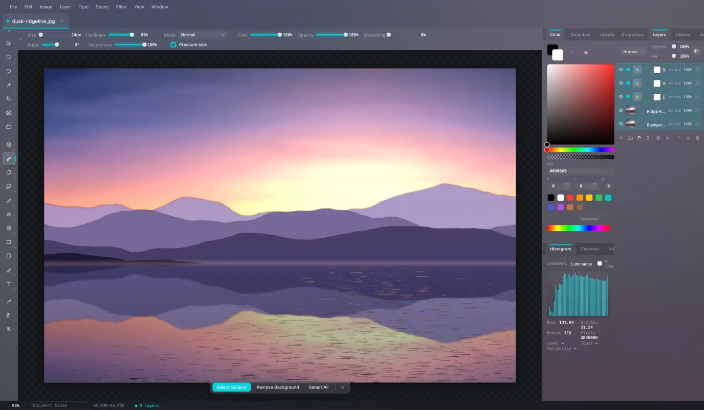

## The apps

| App | Workspace |
| --- | --- |
| 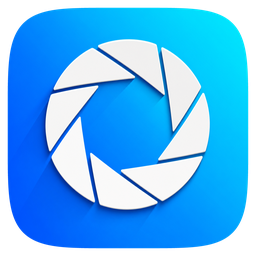 [**Vision**](apps/vision) | Raster image editing with layers, masks and adjustments |
|  [**Artisan**](apps/artisan) | Vector illustration with shapes, paths and typography |
|  [**Cinema**](apps/cinema) | Video editing with clips, tracks and titles |
| 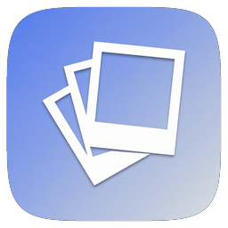 [**Galerie**](apps/galerie) | Photo cataloging and RAW development |
| 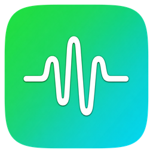 [**Rythme**](apps/rythme) | Audio recording, editing and mixing |
| 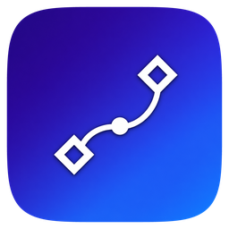 [**Anime**](apps/anime) | Motion graphics and compositing |
|  [**Jouer**](apps/jouer) | 2D game and animation editing |

<table>
  <tr>
    <td width="50%">
      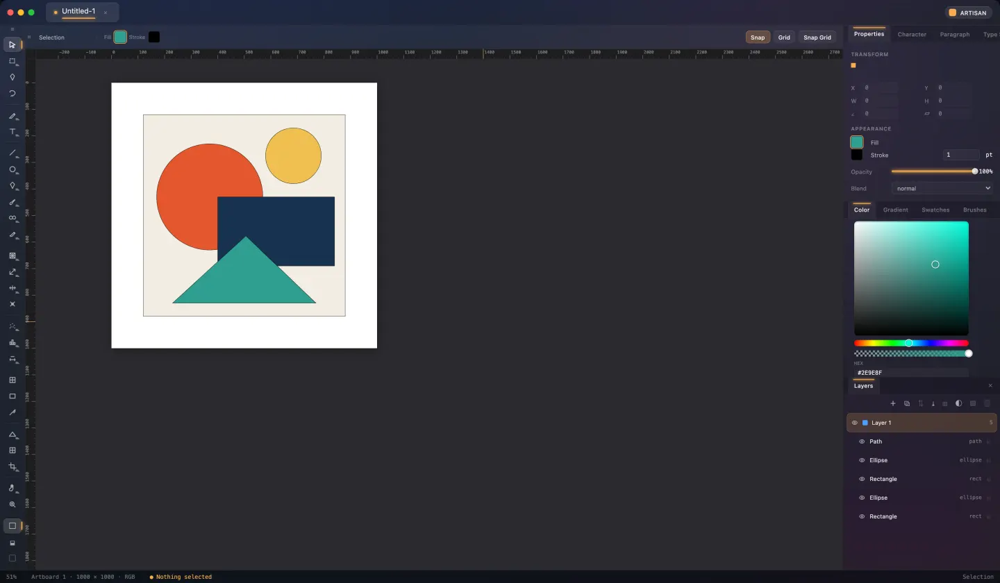
      <p><strong>Artisan</strong> · Vector illustration</p>
    </td>
    <td width="50%">
      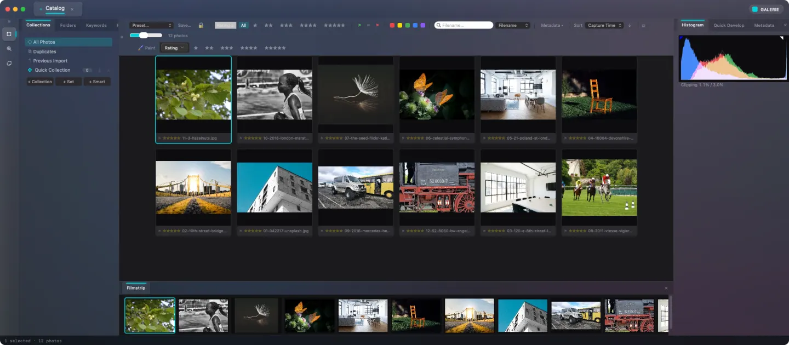
      <p><strong>Galerie</strong> · Photography</p>
    </td>
  </tr>
  <tr>
    <td width="50%">
      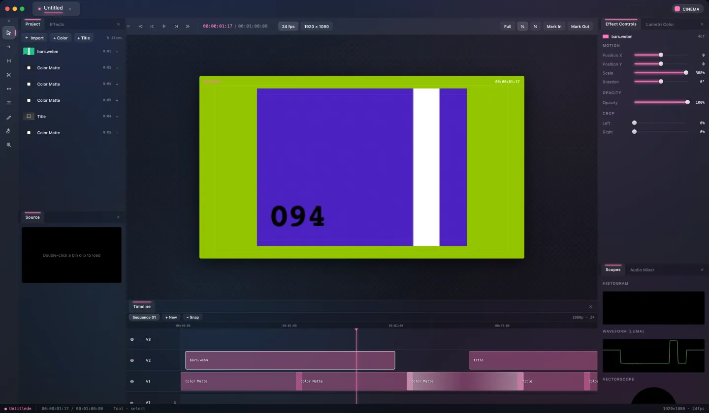
      <p><strong>Cinema</strong> · Video editing</p>
    </td>
    <td width="50%">
      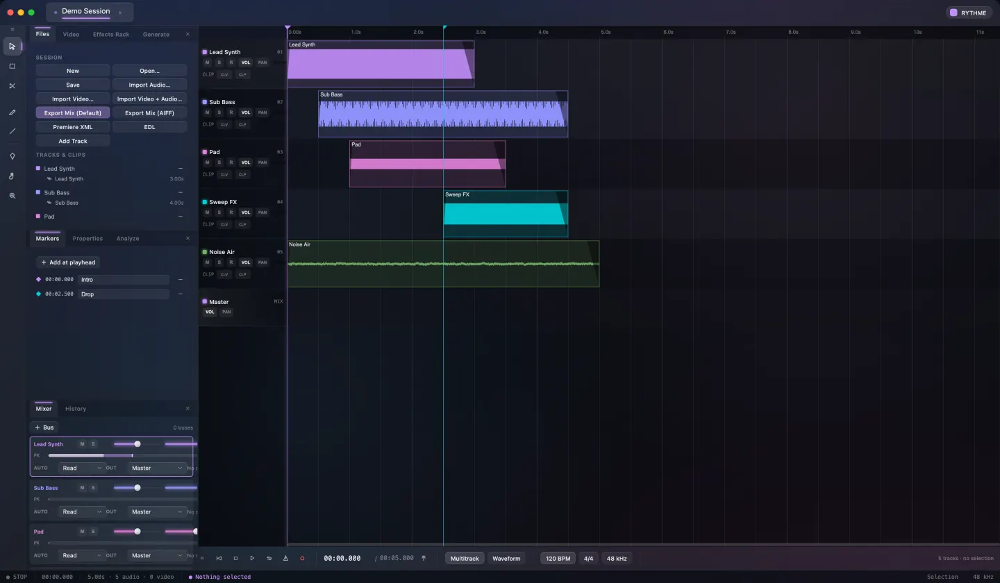
      <p><strong>Rythme</strong> · Audio production</p>
    </td>
  </tr>
  <tr>
    <td width="50%">
      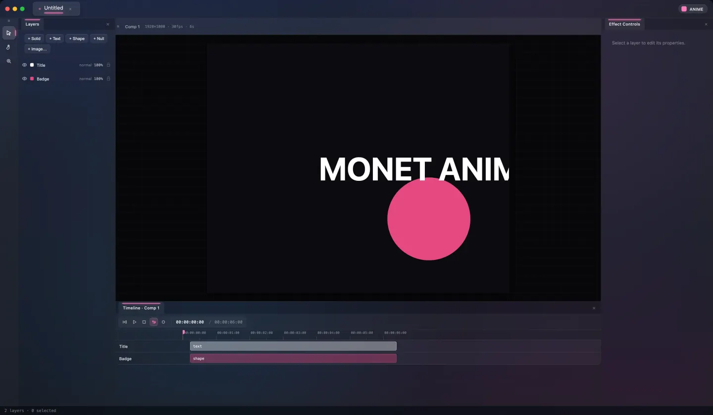
      <p><strong>Anime</strong> · Motion graphics</p>
    </td>
    <td width="50%">
      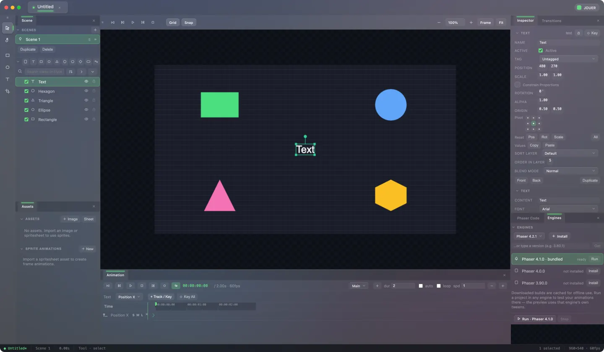
      <p><strong>Jouer</strong> · Games and animation</p>
    </td>
  </tr>
</table>

## Build and run

Install **Node.js 24** (pinned in [`.nvmrc`](.nvmrc)), **pnpm 11.1.3**, **Rust stable** and **wasm-pack 0.13.1**, plus the [Tauri system prerequisites](https://v2.tauri.app/start/prerequisites/) for your platform. On macOS, install the Xcode command-line tools. Detailed setup is in [CONTRIBUTING.md](CONTRIBUTING.md).

```sh
git clone https://github.com/monetone/monet.git
cd monet
pnpm install --frozen-lockfile
pnpm build:libs
pnpm build:engines
pnpm dev:vision
```

`build:libs` builds the shared packages into `dist/` and compiles the format WASM module. `build:engines` builds the rendering engines used by Vision, Artisan, Cinema and Galerie. Run both before starting an app from a clean checkout.

Each development command launches a native Tauri window and its Vite server. Apps have separate ports so you can run them side by side:

| Command | Port |
| --- | --- |
| `pnpm dev:vision` | 1420 |
| `pnpm dev:artisan` | 1421 |
| `pnpm dev:cinema` | 1422 |
| `pnpm dev:jouer` | 1423 |
| `pnpm dev:rythme` | 1424 |
| `pnpm dev:anime` | 1425 |
| `pnpm dev:galerie` | 1426 |

### Release builds

After the setup above, build one app or the whole suite:

```sh
pnpm --filter monet-vision run tauri build
pnpm tauri:build
```

Bundles are written to each app's `src-tauri/target/release/bundle/` directory by default. Keep the engine build step when building Artisan: its Tauri build hook only builds the frontend.

### Workspace commands

Run these from the repository root:

| Command | Purpose |
| --- | --- |
| `pnpm build:libs` | Build the shared `@monet-ui/*` packages |
| `pnpm build:engines` | Build all four app rendering engine outputs |
| `pnpm build:web` | Build every app's frontend |
| `pnpm typecheck` | Run workspace TypeScript checks |
| `pnpm lint` | Run workspace ESLint checks where defined |
| `pnpm test` | Run workspace unit suites and documentation tests |
| `pnpm mcp:codegen` | Regenerate the apps' MCP command manifests |
| `pnpm mcp:check` | Check that generated MCP manifests match their source |
| `pnpm collab:server` | Start the collaboration relay |

Native Rust and end-to-end checks are defined in the individual apps; `pnpm test` runs the unit and documentation suites.

## Shared foundations

- **Monet UI.** Reusable React controls, design tokens, dockable panels and native Tauri integration live in [packages/monet-ui](packages/monet-ui). The full source is included in this repository.
- **Rendering.** Vision, Artisan and Galerie use [monet-render-engine](packages/engine), a shared Rust engine compiled to WebAssembly. Cinema has a separate [rendering engine](apps/cinema/engine).
- **Document formats.** Shared Rust and TypeScript models and codecs support Monet containers, timeline documents and the `.monetgfx` raster/vector graphics format. See [the engine and format guide](docs/merged-engine-and-format.md).
- **Automation.** Every app exposes a local [Model Context Protocol server](docs/mcp.md) so compatible clients can inspect and operate the live app.
- **Durable saves.** Shared [atomic save helpers](docs/durable-save.md) protect the previous document while a replacement is written.
- **Collaboration.** [Yjs-based sessions and a WebSocket relay](docs/realtime-collaboration.md) provide shared document and presence infrastructure.

## Repository layout

```text
apps/                     Seven Tauri + Vite + React apps
packages/engine/          Shared raster and vector Rust/WASM engine
packages/monet-ui/
  packages/               Shared TypeScript and React packages
  crates/                 Shared Rust UI, format, database and MCP crates
docs/                     Architecture and workflow guides
site/                     Project site and app screenshots
scripts/                  Repository tooling and collaboration relay
```

JavaScript packages use pnpm `workspace:*` dependencies. Each app's `src-tauri/` is a standalone Cargo workspace and depends on shared Rust crates by path.

## Contributing

Bug reports, focused improvements, tests and documentation are welcome. Use the [issue tracker](https://github.com/monetone/monet/issues) to describe a problem or discuss a larger change, and read [AGENTS.md](AGENTS.md) for project conventions.

Read [CONTRIBUTING.md](CONTRIBUTING.md) for setup and targeted checks. Report
vulnerabilities privately using [SECURITY.md](SECURITY.md).

Run the checks relevant to your change before opening a pull request. For shared code, include the affected apps; for MCP command changes, regenerate the manifests and run `pnpm mcp:check`.

Useful guides:

- [MCP commands and code generation](docs/mcp.md)
- [Durable document saves](docs/durable-save.md)
- [Merged rendering engine and graphics format](docs/merged-engine-and-format.md)
- [Content Credentials and C2PA signing](docs/c2pa-signing.md)
- [Realtime collaboration](docs/realtime-collaboration.md)

## License

Monet is licensed under [MIT](LICENSE). See [NOTICE](NOTICE) for bundled third-party code and attribution.
